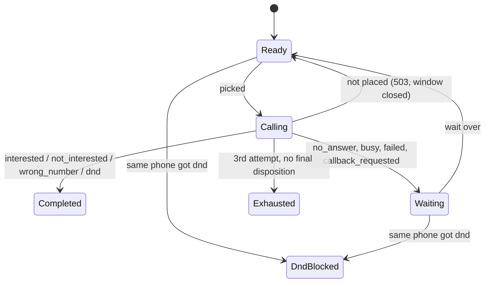

# Submission

## Candidate
- **Name:** Abhinav Karnatak
- **Assignment chosen:** B (Workflow)
- **Time spent (honest estimate):** 6h

## How to run
Needs Python 3.11+ and the [Temporal CLI](https://docs.temporal.io/cli). Three terminals, each
from the repo root with the virtual environment active.

```bash
# setup (once)
python -m venv .venv && source .venv/bin/activate     # Windows: .venv\Scripts\activate
pip install -r requirements.txt

# terminal 1: Temporal server
cd solution && temporal server start-dev --db-filename temporal.db

# terminal 2: the provider
cd assignment-b-workflow && python -m mock_telephony

# terminal 3: the dispatcher
cd solution
python -m dispatcher run       # runs until every lead is final, writes final_state.csv
python -m dispatcher verify    # compares final_state.csv with /admin/leads, prints /admin/report

# tests
cd solution && pytest

# crash test (instead of "dispatcher run", with a fresh provider): kills the dispatcher
# 5 times while calls are in flight, restarts it, then runs verify
cd solution && python tools/chaos.py
```

More detail is in [`solution/README.md`](solution/README.md).

## Design
- **Temporal.** One process runs a webhook receiver (FastAPI), a Temporal worker, and one
  workflow that owns all 200 leads. Calls to the provider happen in activities
  (`place_call`, `get_call`). Webhook results go into the workflow as a signal.
- **One workflow for all leads**, because three rules are global: the tenant call limit is
  shared across campaigns (R2), one phone can't have two calls at once (R3), and DND blocks a
  phone in every campaign (R8). With all leads in one place these are simple checks.
- **Rules are pure functions** (`solution/dispatcher/scheduling.py`) that take the simulated
  time and return decisions, so they are easy to test with a fake clock.
- **Lost webhooks:** for every accepted call, the workflow checks the provider itself
  (`GET /v1/calls/{call_sid}`) if no result has arrived 8 simulated minutes after the call
  started (longer than any call can last).

**Lead state machine:**


**At-most-once dialling:**
1. Every attempt gets a `request_id` (`campaign:lead:dN`) chosen before anything is sent and
   saved in Temporal's history. Every retry uses the same id, and the provider places at most
   one call per id.
2. After a `504` or a timeout, we look the call up by `request_id`. Found means it was placed;
   not found means retry with the same id.
3. After a crash, Temporal re-runs the activity with the same input, so the same `request_id`.

## Decisions & assumptions

| Decision | Why | Alternative considered |
|---|---|---|
| Temporal | Workflow state, timers and pending retries are stored on the Temporal server, so after `kill -9` the worker replays history and continues from the same point | SQLite state machine: I would have to save every state change, recover half-finished calls on restart, and write my own poller for retries, callbacks and lost results |
| One workflow for all leads | R2, R3 and R8 are global, so one owner means no races | One workflow per lead |
| Check the provider 8 sim minutes after a call starts | Recovers lost webhooks quickly instead of waiting for the provider's retries | Only trusting webhooks |
| 0.5 s timeout on `POST /v1/calls` | The provider sometimes hangs 2 real seconds (20 sim minutes) before a `504`. Safe because of the `request_id` lookup | Default 5 s timeout, which made callbacks very late |
| Keep a tenant slot free for a callback that is due in the next 7 sim minutes | R6: call callbacks as soon as possible | Plain priority order only |

## Failure modes considered
- **`kill -9`:** Temporal keeps the workflow; restarting re-attaches to it and continues.
- **`503`:** retried with the same `request_id`; not counted as an attempt.
- **Ambiguous `504`:** looked up by `request_id` before retrying.
- **Duplicate webhooks:** each `call_sid` is applied once.
- **Lost webhooks / webhooks sent while we were down:** the workflow checks the provider itself.
- **Bad webhook signature:** rejected with `401`.

**Not handled:** two dispatcher processes at the same time (not built or tested).

## Testing
- 124 tests (`pytest`): scheduling rules with a fake clock, the provider client against a fake
  provider (503, 504, timeouts), the workflow on a real Temporal test server (duplicate and lost
  webhooks, a crash midway), and the webhook receiver.
- Full runs against the real provider, plus the crash test (`kill -9` 5 times). Every run: all
  200 leads match and 0 violations.

## Results
Clean run:
```
final_state.csv matches /admin/leads: every lead
violation_count: 0
calls_total: 407   max_concurrency_seen: {'acme_insurance': 4, 'zen_retail': 3}
callback_lateness_minutes: {'count': 64, 'p50': 2.7, 'p90': 9.0, 'max': 15.1}
webhooks: {'delivered': 427, 'duplicates': 35, 'lost': 15}
```

With 5 × `kill -9` (`tools/chaos.py`, down 10 real seconds each time):
```
final_state.csv matches /admin/leads: every lead
violation_count: 0
callback_lateness_minutes: {'count': 64, 'p50': 4.3, 'p90': 56.7, 'max': 3819.4}
```
The high lateness comes from the downtime: 10 real seconds is 100 simulated minutes at 600x.
One kill happened just as Zen's Friday window closed, so a callback due Friday 17:50 could only
be made Monday 09:30.

## If I had another day
1. Support two dispatcher processes running at once.
2. Lower callback lateness further.
